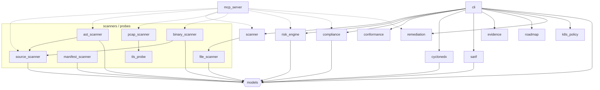

# Q-Trust Architecture

## Overview

Q-Trust is a post-quantum cryptography (PQC) migration assurance platform that registers, plans, and audits cryptographic asset migrations on-chain. It combines Solidity smart contracts, a Fastify backend API, a Python SDK, a TLS/file inspector, and a GNN-based planner to guide organizations from legacy algorithms to NIST-approved PQC standards.

## Contract Layer

All eleven contracts are Solidity 0.8.24, UUPS-proxy upgradeable via OpenZeppelin `ERC1967Proxy`, and use `AccessControl` role-based permissions. Admin operations route through `QTrustGovernance` (7-day timelock, `DEFAULT_DELAY = 7 days`). Gasless meta-transactions use EIP-712 typed signatures with nonce tracking.

| Contract | Description |
|---|---|
| **AssetRegistry** | Registers CBOM hashes (SHA-256) with IPFS metadata URIs; supports EIP-712 gasless registration. |
| **VendorRegistry** | Vendors (DigiCert, Thales, AWS) post PQC-readiness attestations per product/version/algorithm. |
| **MigrationRegistry** | Records each migration step (from-algo → to-algo) with evidence hashes; validates asset existence against AssetRegistry. |
| **AuditRegistry** | Third-party auditors post attestation results (Passed/Failed/Conditional); binds to on-chain migration count. |
| **EvidenceRegistry** | Stores verifiable evidence records (hashes + metadata) referenced by audits and migrations for tamper-evident traceability. |
| **QTrustGovernance** | Timelock-gated wrapper around the four core registries for pausing, retiring, role grants, and upgrades. |
| **RevocationAnchor** | Anchors off-chain Merkle roots for privacy-preserving credential revocation checks. |
| **PolicyCommitment** | Versioned on-chain policy hash anchors for reproducible trust assessments. |
| **ComplianceAttestation** | Records regulatory/compliance attestations (jurisdiction, standard, status) bound to assets and vendors. |
| **SchemaRegistry** | Registers JSON Schema documents for CBOM/credential formats with cross-domain equivalence mappings. |
| **TrustAnchorRegistry** | Accreditation of credential issuers by governance multisig; verifiers reject non-accredited issuers. |

## Backend API

- **Runtime:** Fastify (TypeScript ESM) on port 3001, proxied by Next.js at `/api/*`.
- **Data stores:** PostgreSQL via indexer service, Redis (optional) for webhook subscriptions.
- **Key endpoints:**
  - `GET /v1/assets/:id/verify` — on-chain asset verification
  - `GET /v1/orgs/:did/summary` — organization dashboard data
  - `POST /v1/write/assets` — admin CBOM registration (API-key gated)
  - `POST /v1/relay/attestation` — EIP-712 gasless attestation relay
  - `POST /v1/webhooks/subscribe` — real-time event subscriptions
- **Hardening:** CORS allowlist, API-key auth on writes, 1 MB body limit, rate limiting, JSON schema validation, deprecation headers on legacy routes.

## SDK

- **Language:** Python (`qtrust` package).
- **Core class:** `QTrustClient` — connects to Base Sepolia via Web3.py, wraps all four core registry ABIs.
- **Key modules:** `cbom.py` (CBOM builder), `ipfs.py` (Pinata pinning with retry + multi-vendor fallback), `schema.py` (Pydantic models for `CBOM`, `AssetRecord`, `MigrationRecord`, `ProductAttestation`).
- **Chain:** Base Sepolia (chain-id 84532) by default; configurable to Base mainnet.

## Inspector

- **Entry:** `qtrust_inspector.cli` CLI module.
- **Core class:** `CryptoScanner` — performs TLS handshakes (Python `ssl` + `cryptography`), optional Nmap port scanning, PEM file scanning, and SSH key inspection.
- **Output:** `ScanResult` containing `AssetFinding` objects serialized as CBOM JSON conforming to schema `qtrust.cbom.v1`.
- **PQC awareness:** Recognizes ML-KEM, ML-DSA, SLH-DSA, HQC, FALCON, SPHINCS+ and maps legacy algorithms (RSA, ECC, DSA) with criticality scoring.

Module dependencies (derived from actual imports):



Dataflow: `cli` drives `scanner`, which fans out to the format-specific
probes (`ast_scanner`/`binary_scanner` reuse `source_scanner`'s skip rules;
`pcap_scanner` reuses `tls_probe`'s codepoint tables); every probe emits
`models.AssetFinding`. Those findings flow through `risk_engine`,
`compliance`/`conformance` scoring into the output layers — `cyclonedx`
(CBOM), `sarif`, `evidence`, `roadmap`, `remediation`, and `k8s_policy`.
`mcp_server` wraps the same scan/risk/compliance surface as JSON-RPC tools for
AI coding agents.

## Planner

- **Runtime:** FastAPI microservice (port 8080) with rate limiting (60 req/min per IP).
- **Model:** `MigrationGNN` — PyTorch Geometric GCN that takes a cryptographic-asset dependency graph and outputs per-node priority and risk logits.
- **Node features:** `[algorithm_type, key_size, vendor_pqc_ready, criticality]`.
- **Fallback:** Rule-based heuristic when no trained model file (`model.pt`) is available.
- **Endpoints:** `POST /plan` (CBOM → ordered migration plan), `POST /plan/deadline` (feasibility check).

## Frontend

- **Framework:** Next.js (React 19) with Tailwind CSS.
- **Pages:**
  - `/` — landing page
  - `/dashboard` — organization summary view (role-gated)
  - `/v` — verification index
  - `/v/:id` — individual asset verification page
  - `/vendors` — vendor attestation explorer
- **Proxy:** Next.js rewrites `/api/*` to the Fastify backend at `localhost:3001`.

## Data Flow

```
Inspector scan → CBOM JSON (qtrust.cbom.v1)
  → SDK pins to IPFS, computes SHA-256 hash
    → AssetRegistry.registerCBOMSigned (EIP-712 gasless)
      → Planner reads CBOM, builds dependency graph
        → MigrationGNN outputs priority-ordered migration plan
          → MigrationRegistry.recordMigrationSigned per step
            → AuditRegistry.postAudit by third-party auditor
              → TrustAnchorRegistry / RevocationAnchor for credential lifecycle
```

## Network

- **Testnet:** Base Sepolia — chain-id `84532`, RPC via `QTRUST_BASE_SEPOLIA_RPC` env var.
- **Mainnet:** Base — enabled with `QTRUST_USE_MAINNET=true`.
- **Client:** viem `PublicClient` for read calls; `WalletClient` with deployer private key for writes.

## Security Model

- **RBAC:** OpenZeppelin `AccessControl` with named roles per contract (REGISTRAR_ROLE, VENDOR_ROLE, MIGRATOR_ROLE, AUDITOR_ROLE).
- **Timelock:** `QTrustGovernance` wraps all admin mutations through a 7-day `TimelockController` (`DEFAULT_DELAY = 7 days`), preventing single-key compromise.
- **EIP-712:** Gasless meta-transactions for CBOM registration, vendor attestations, migration recording, and revocation root updates. Domain-separated typed hashes with per-address nonces.
- **Replay protection:** Sequential nonce mapping per signer; signature recovery validates the signer matches the claimed org/vendor/issuer.
- **Pausability:** Every registry can be emergency-paused by the admin; governance can schedule unpause through the timelock.
